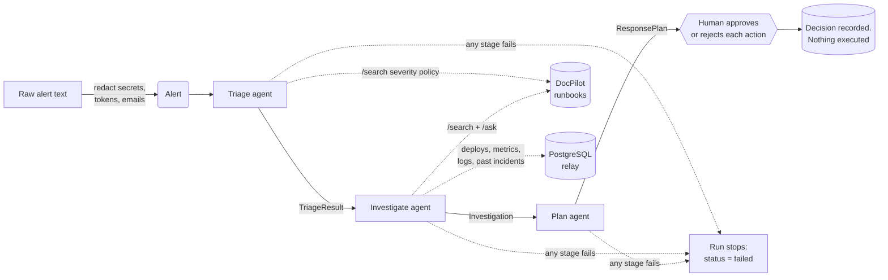

# Relay

A multi-agent incident-response assistant. When a production alert fires, three agents triage it,
investigate it with runbooks and system data, and propose next steps. A human approves or rejects
each step. **Relay never executes anything**: there is no code path that runs an action.

Built with Python 3.12, FastAPI, LangGraph, Pydantic and PostgreSQL. It uses any OpenAI-compatible
LLM (Groq by default) and gets runbook knowledge from
[DocPilot](https://github.com/Gayathri2708/docpilot-rag).

## Architecture



The pipeline is a LangGraph `StateGraph` (`relay/graph.py`). Each edge carries a typed Pydantic
contract (`relay/schemas.py`):

| Stage | Input | Output | What the agent does |
|---|---|---|---|
| Triage | `Alert` | `TriageResult`: service, severity P1–P4, symptoms, start time, policy section | Pulls the severity policy from DocPilot and classifies the alert against it |
| Investigate | `TriageResult` | `Investigation`: findings, each citing evidence ids, plus the evidence | Gathers evidence from runbooks (`/search`, `/ask`), recent deploys, metric and log snapshots for the service and its dependencies, and similar past incidents, then reasons over it |
| Plan | `TriageResult` + `Investigation` | `ResponsePlan`: ordered actions, each citing a runbook section | Proposes rollback, scaling, flags, paging, status updates and so on; risky actions are flagged for approval |

### How invalid output is handled

Every LLM call goes through `structured_call()` (`relay/llm.py`):

1. The reply must parse as JSON and validate against the stage's Pydantic schema.
2. It must then pass checks against the evidence the agent actually holds:
   - **Triage:** the policy section exists in the retrieved policy and agrees with the severity, and the start time is not in the future.
   - **Investigate:** every finding cites at least one evidence id, and every cited id was really gathered.
   - **Plan:**
     - every citation names a runbook section that was retrieved, in the right file;
     - P1 and P2 incidents include paging and a status update;
     - status updates don't name internal systems;
     - a "read-only" action can't describe changing production.
3. On failure the model is told exactly what was wrong and retries (`LLM_MAX_RETRIES`, default 2).
4. When retries run out, the stage raises an error. The graph routes the run to `failed` and later
   stages never run. Invalid output is never passed on.

### Safety properties

- **Nothing auto-executes.** `ResponsePlan.executed` is the literal `False`. The approval endpoint
  records a decision and nothing else. Decisions are final (a second one returns 409).
- **Risky actions always need approval, whatever the model says.** These are rollback, scale_up,
  feature_flag, failover, restart, config_change and terminate_query. The `ProposedAction` contract
  forces `risk="high"` and `requires_approval=True` for them. Status updates also need approval
  before publishing, per policy COMM-1.
- **Redaction happens in layers:**
  - Alerts are redacted when they are created.
  - Log evidence is redacted when it is gathered.
  - `structured_call()` redacts every message again before it leaves the process.
  - Covered: emails, bearer tokens, JWTs, API keys (Stripe, OpenAI, Groq, GitHub, Slack, AWS,
    DocPilot), `password=`-style values, URL credentials, private keys, and Luhn-valid card numbers.
  - Only redacted alert text is stored.
- **Verifiable citations.** Every runbook heading carries an id such as `[PAY-2]`. A plan can only
  cite ids whose heading was in the runbook text it retrieved.
- **Least privilege.** Relay reads DocPilot with a read-only `engineering` key. The admin key is
  used only by the upload script.

## Setup

Prerequisites: Python 3.12, PostgreSQL (e.g. Homebrew), and DocPilot running on `localhost:8000`.

```bash
python3.12 -m venv .venv && source .venv/bin/activate
pip install -e ".[dev]"

createdb relay
cp .env.example .env           # then fill in LLM_API_KEY (your Groq key) and the DocPilot keys

python -m seed.seed_db         # fake deploys, metrics, logs and past incidents for "Brightcart"
python -m seed.upload_runbooks # puts seed/runbooks/*.md into DocPilot's engineering group (admin key)
```

For a local DocPilot, its demo keys work: `DOCPILOT_API_KEY=dp_demo_engineering` (read-only) and
`DOCPILOT_ADMIN_KEY=dp_demo_admin`. Anywhere real, create keys with
`python -m app.auth create-key relay --groups engineering` in DocPilot.

## Running

**CLI**, using a sample alert from `seed/alerts/`:

```bash
python -m relay.cli seed/alerts/payments-5xx-after-deploy.txt          # human-readable
python -m relay.cli seed/alerts/checkout-latency-sale.txt --json --save # store for approval
```

**API**:

```bash
uvicorn relay.api:app --port 8100

curl -X POST localhost:8100/incidents -H 'content-type: application/json' \
  -d "{\"alert\": $(jq -Rs . < seed/alerts/auth-invalid-signature.txt)}"
curl localhost:8100/incidents
curl localhost:8100/incidents/<run-id>
curl -X POST localhost:8100/incidents/<run-id>/actions/A2/decision \
  -H 'content-type: application/json' -d '{"decision": "approved", "decided_by": "ic-on-call"}'
```

| Endpoint | Purpose |
|---|---|
| `POST /incidents` | Run the pipeline on raw alert text; returns the stored run (`awaiting_approval` or `failed`) |
| `GET /incidents` | Recent runs with service and severity |
| `GET /incidents/{id}` | Full run: alert, triage, investigation with evidence, plan, decisions |
| `POST /incidents/{id}/actions/{action_id}/decision` | Record `approved` or `rejected`. Does not execute anything |

### Seed scenarios

| Alert | What the data shows | Expected outcome |
|---|---|---|
| `payments-5xx-after-deploy.txt` | payments-api errors 15 min after deploy v2.41.0; processor and DB healthy | P1, roll back (PAY-2/DEP-2), page payments |
| `checkout-latency-sale.txt` | traffic tripled in a flash sale, CPU 93%, no deploy | P2, scale up and shed recommendations (CHK-4) |
| `auth-invalid-signature.txt` | JWT key rotation removed the old key | P1, re-publish previous key (AUTH-2) |
| `orders-db-replica-lag.txt` | analytics query on a replica | P2, terminate query (DB-4); **no** failover (DB-2 forbids it) |

## Tests and CI

```bash
ruff check . && pytest -q
```

Every agent is tested against a scripted fake LLM. The tests use an in-memory DocPilot built from
the real seed runbooks, plus fake ops data, so no network, key or database is needed. They cover:
- the happy paths;
- retry on each kind of invalid output;
- failure after retries run out, and that failed stages stop the graph;
- redaction at every boundary;
- enforcement of approval for risky actions;
- the API's decision rules.

GitHub Actions runs ruff and pytest on every push and pull request.

## Layout

```
relay/
  schemas.py        typed contracts between stages, safety rules on ProposedAction
  llm.py            OpenAI-compatible client, structured_call (validate + retry)
  redact.py         secret and PII scrubbing
  graph.py          LangGraph pipeline and failure routing
  agents/           triage.py, investigate.py, plan.py
  tools/            docpilot.py (search/ask), ops.py (deploys, metrics, logs, past incidents)
  store.py          runs and decisions (Postgres, in-memory for tests)
  api.py, cli.py
seed/
  runbooks/         six Brightcart runbooks (uploaded to DocPilot)
  alerts/           sample alerts matching the seeded data
  seed_db.py, upload_runbooks.py
tests/
```

## Design notes and limits

- **The investigate agent's tool calls are fixed, not chosen by the model.** The triage result
  decides which tools run, and the LLM reasons over what comes back. A model-driven tool loop can
  skip sources and is harder to audit and test. The trade-off is that the agent can't follow a
  hunch to a tool it wasn't given.
- **DocPilot search is required; the other tools are optional.** If DocPilot search is down, the
  run fails, because a plan with no runbooks to cite is not trustworthy. If a deploy, metrics or
  past-incident lookup fails, that becomes `tool_error` evidence and the run continues.
- **DocPilot does not chunk on headings.** It packs sentences into windows of about 1000
  characters. Runbook sections are kept short so most chunks carry a section id. The investigate
  agent also follows cross-references (such as "follow [DEP-2]") with a hybrid search, so the plan
  can cite the procedure itself.
- **Runs are synchronous.** `POST /incidents` takes as long as three LLM calls (about 30–60 s on
  Groq). A queue would be the next step for real traffic.
